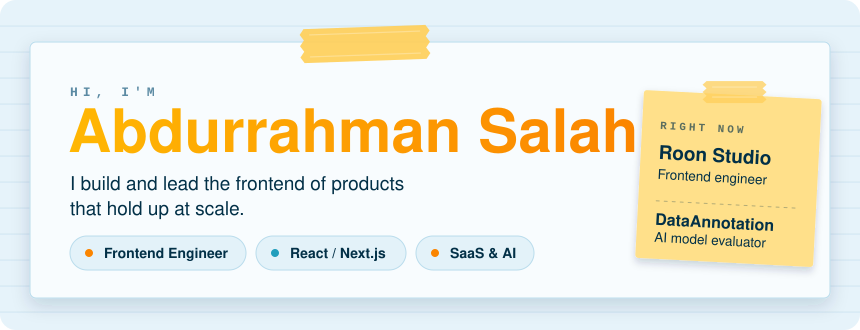
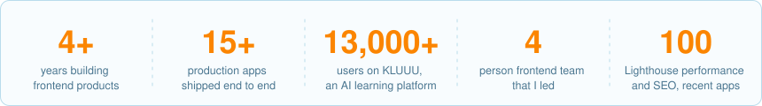
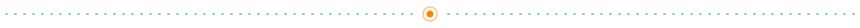

<picture>
  <source media="(prefers-color-scheme: dark)" srcset="assets/header-dark.svg">
  
</picture>

 

**[Portfolio](https://amazing-portfolio-rho.vercel.app/)** &nbsp;·&nbsp; **[LinkedIn](https://www.linkedin.com/in/abdurrahman-salah-489798203)** &nbsp;·&nbsp; **[Email](mailto:abdoarafh54@gmail.com)** &nbsp;·&nbsp; **[Résumé](https://amazing-portfolio-rho.vercel.app/resume.pdf)**

 

I'm a frontend engineer in Egypt who likes owning the whole product surface: the design handoff (or the lack of one), the awkward state, the integrations, and the part where it has to be fast.

Since 2022 I've shipped **15+ production apps** at Roon Studio for clients in the USA, Germany, Turkey and India, and I led a four-person frontend team there. Most of it is React, Next.js and TypeScript, across SaaS, AI, enterprise and content platforms.

<picture>
  <source media="(prefers-color-scheme: dark)" srcset="assets/stats-dark.svg">
  
</picture>

## The kind of problems I take on

- **Features with a lot of moving parts.** Auth, Stripe payments, real-time communication over WebSockets, Gemini-powered AI, PDF generation, drag-and-drop interfaces, and CMS-driven content (Strapi, Contentful, WordPress).
- **Apps that stay fast.** SSR/SSG, caching and optimistic updates. My recent apps score 100 on Lighthouse Performance and SEO, with Accessibility close behind.
- **Codebases a team can grow in.** Reusable component architecture, shared hooks, project-level UI kits and written standards, backed by code review and mentoring.
- **Products with no spec.** I've built apps where no design was handed over, and rebuilt legacy HTML/jQuery templates into maintainable React.

## Selected work

<table>
<tr>
<td width="33%" valign="top">

### [KLUUU](https://kluuu.app)
**AI learning platform** &nbsp;·&nbsp; 13,000+ users

`Next.js` `TypeScript` `Tailwind`

Interactive learning flows and AI-assisted quiz generation. I also refactored AI-generated frontend code into structured, reusable components, giving the product a maintainable foundation to keep building on.

</td>
<td width="33%" valign="top">

### Create Ads
**TV advertisement platform**

`Next.js` `TanStack Query` `Zustand` `Zod`

Create and manage video ads entirely in the browser. Media generation runs client-side with **FFmpeg**, so the core workflows need no dedicated server-side processing.

</td>
<td width="33%" valign="top">

### FCE
**Enterprise logistics platform**

`React` `MUI` `Express` `Zod`

Dashboards for shipment tracking and operational workflows. Role-based UI over data-heavy screens, with typed REST APIs validated by Zod.

</td>
</tr>
</table>

More notes on each in the [portfolio](https://amazing-portfolio-rho.vercel.app/).

## Two problems I enjoyed

**Lines that follow the layout** &nbsp;·&nbsp; [CLX Labs](https://clx-labs.vercel.app/about)

A designer wanted background lines that follow the page layout, not a static SVG. Drawing them by hand would break every time the page reflowed, so I made a tiny language for it. Each line is a list of points. A point can lock to a real element's edge, like `refrb(#id).left` or `.top`, and a `*` marks a main point. The paths rebuild on scroll and resize, so the lines stay attached to the layout.

**Reading the competitor's PDF** &nbsp;·&nbsp; CLP label designer, 2023

A client wanted a product to compete with a well-known online label maker. I tried to build it with `react-pdf`, but parts of the label were impossible to make in the browser back then. So I looked at what the competitor actually exported and found it was an image inside a PDF. I built the product the regular way: HTML, then HTML to image, then image to PDF.

## On the side

- **[case-alchemy](https://github.com/AbdoArafh/case-alchemy)** is a light, tree-shakable library for converting text between cases (camel, kebab, snake and so on), with custom transforms. It's on [npm](https://www.npmjs.com/package/case-alchemy) and released with semantic-release.
- **[amazing-portfolio](https://github.com/AbdoArafh/amazing-portfolio)** is my [portfolio](https://amazing-portfolio-rho.vercel.app/). Sections change through a React port of Codrops' SliceRevealer, cards are taped and pinned to a paper desk, and one five-colour palette drives both light and dark themes.
- **[prayer-streak](https://github.com/AbdoArafh/prayer-streak)** tracks the five daily prayers on a Saturday-start week, with a public leaderboard and push notifications. React, Bun and SQLite.
- **[calendar](https://github.com/AbdoArafh/calendar)** generates a calendar for any city and any day, ready to print.
- Small live tools: [smooth-typing](https://smooth-typing.vercel.app) and [images-pdfier](https://images-pdfier.vercel.app), which turns uploaded images into a PDF.

## Path

<table>
<tr>
<td width="170"><b>Apr&nbsp;2022&nbsp;to&nbsp;now</b></td>
<td width="130"><b>Roon Studio</b></td>
<td width="100%">Frontend engineer. 15+ production apps, end to end. Led a four-person frontend team.</td>
</tr>
<tr>
<td><b>Mar&nbsp;2026&nbsp;to&nbsp;now</b></td>
<td><b>DataAnnotation</b></td>
<td>AI model evaluator. Comparing AI agents on reasoning, coding and complex task execution, and writing structured evaluations for human-in-the-loop model training.</td>
</tr>
<tr>
<td><b>Dec&nbsp;2021&nbsp;to&nbsp;Mar&nbsp;2022</b></td>
<td><b>Tortoiz Themes</b></td>
<td>5+ commercial React templates across 80+ responsive pages. Replaced a legacy jQuery toolchain, taking iteration time from minutes to milliseconds.</td>
</tr>
</table>

## Toolbox

<table>
<tr>
<td width="130"><b>Build</b></td>
<td width="100%">React, Next.js, TypeScript, React Router, Tailwind, MUI, shadcn/ui, Framer Motion</td>
</tr>
<tr>
<td><b>Data and state</b></td>
<td>TanStack Query, Zustand, Zod, React Hook Form, REST, GraphQL, WebSockets</td>
</tr>
<tr>
<td><b>Integrate</b></td>
<td>Auth.js, Firebase, Stripe, Gemini API, FFmpeg, Strapi, Contentful, WordPress</td>
</tr>
<tr>
<td><b>Care about</b></td>
<td>SSR/SSG, accessibility, SEO, i18n, performance, RBAC, component architecture</td>
</tr>
</table>

## Let's talk

I'm open to remote contract and freelance frontend work, and always up for a conversation about interesting product problems.

**[Portfolio](https://amazing-portfolio-rho.vercel.app/)** &nbsp;·&nbsp; **[LinkedIn](https://www.linkedin.com/in/abdurrahman-salah-489798203)** &nbsp;·&nbsp; **[Email](mailto:abdoarafh54@gmail.com)** &nbsp;·&nbsp; **[Résumé](https://amazing-portfolio-rho.vercel.app/resume.pdf)**

Arabic (native) &nbsp;·&nbsp; English (full professional)

